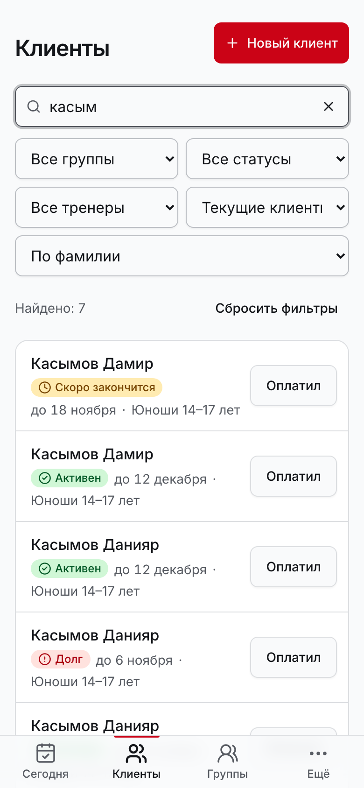
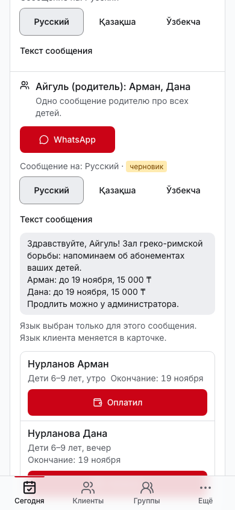
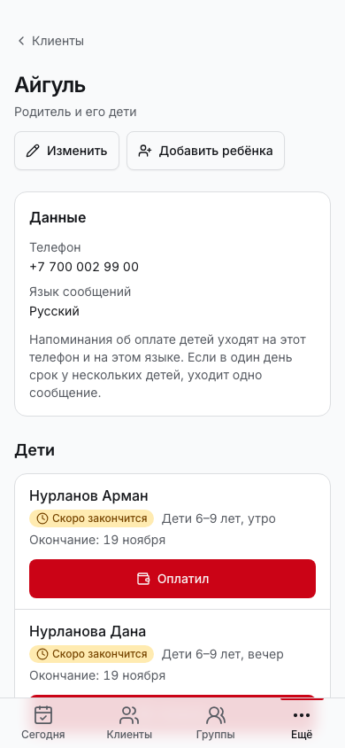
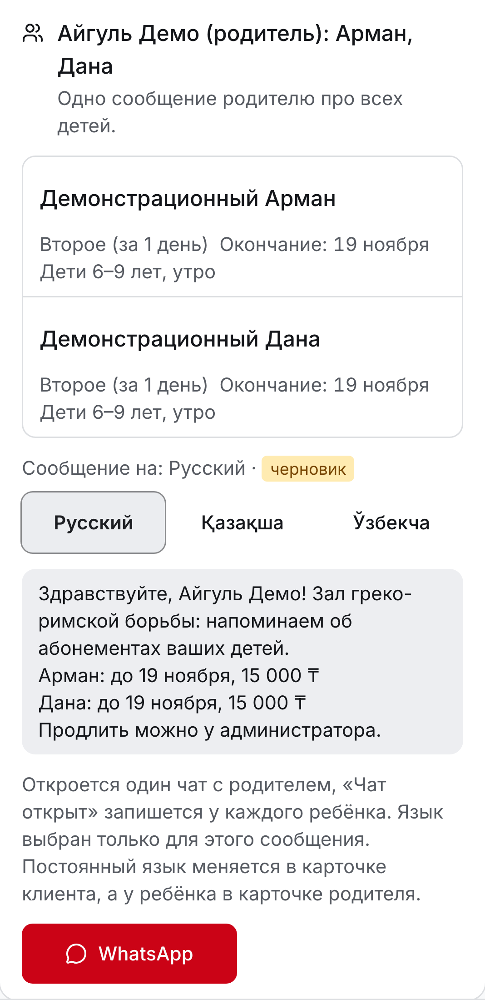

# Инструкция администратора

Сервис заменяет тетрадь: кто занимается, кто оплатил, кому пора напомнить. Адрес: `https://adilkhan-club.vercel.app`. Добавьте его на главный экран телефона, чтобы открывать одним нажатием.

На скриншотах вымышленные клиенты.

## Вход

Почта и пароль выдаёт владелец. При первом входе сервис попросит придумать свой пароль. Забыли пароль: попросите владельца задать новый.

## Каждый день: экран «Сегодня»

Открывается сразу после входа. Сверху четыре счётчика, нажмите любой, чтобы увидеть список. Ниже «Напомнить сегодня»: у этих клиентов абонемент скоро заканчивается или закончился.

- **WhatsApp**: откроется чат с клиентом (или с родителем ребёнка) и готовым текстом. Проверьте текст и нажмите «Отправить» в WhatsApp. В сервисе появится «Чат открыт». Сервис не знает, отправили ли вы сообщение, поэтому после отправки можно нажать «Отметить отправленным».
- **Оплатил**: клиент заплатил, отметьте оплату (ниже).

Пишите только с номера зала в WhatsApp Business.

## Найти клиента

«Клиенты» внизу → начните набирать фамилию, имя или последние цифры телефона. Ребёнка находит и по имени или телефону родителя. Список сужается сразу. Можно набирать и казахскими буквами: «Қасым» найдёт «Касымов».

## Отметить оплату

1. «Оплатил» в строке клиента (или в его карточке).
2. Сумма уже подставлена по цене группы, её можно изменить. Выберите способ: наличные, Kaspi или перевод.
3. «Действует до»: дата уже подставлена, обычно менять её не нужно. Абонемент продлевается со дня после окончания старого, даже если клиент заплатил с опозданием: опоздал на неделю, значит, неделя уже прошла за его счёт. Только если клиент не платил дольше месяца, новый абонемент считается со дня оплаты.
4. «Подтвердить». Появится «Оплата сохранена. Абонемент до …».

**Поменять дату «до».** Нажмите на поле «Действует до» и выберите другое число (например, клиент договорился о другом сроке). Под полем появится «Изменено. По правилу: до …», кнопка «Вернуть дату по правилу» отменяет изменение. Дату можно поставить не раньше сегодняшнего дня и не позже чем через 12 месяцев от начала абонемента; иначе под полем появится подсказка с допустимыми числами, и оплата не сохранится. Сумма от даты не меняется: если клиент платит за больший срок, поправьте сумму сами. Владелец видит каждое изменение даты в «Журнале».

Ошиблись: нажмите «Отменить» во всплывающем сообщении или в карточке клиента в течение 10 минут. Позже исправить оплату может только владелец. Удалить оплату нельзя никому: в истории остаются и оплата, и отмена.

## Карточка клиента

Нажмите на имя. Здесь абонемент (до какого числа, сколько дней осталось), группа, телефон, согласия, история оплат и напоминаний. «Изменить» исправляет данные, «В архив» убирает ушедшего клиента из списка (история сохраняется).

Новый клиент: «Клиенты» → «Новый клиент». Сначала выберите «Взрослый» или «Ребёнок» (о детях ниже) и отметьте, что согласие получено.

**Язык сообщений.** Взрослый клиент получает напоминание в WhatsApp на своём языке: русском, казахском или узбекском. Язык выбирается в форме клиента («Изменить» → «Язык сообщений»), по умолчанию русский. Ваш язык интерфейса на это не влияет. В карточке в разделе «Текст напоминания» видно, что именно прочитает клиент; кнопка «WhatsApp» открывает чат с этим текстом, отправляете вы сами. Сменили язык, и следующее напоминание сразу на новом языке.

**Отправить одно сообщение на другом языке.** Рядом с напоминанием на «Сегодня» и в карточке клиента есть переключатель «Русский / Қазақша / Ўзбекча». Сначала выбран язык из карточки. Нажмите другой язык: текст и ссылка WhatsApp сразу поменяются, над текстом будет написано, например, «Сообщение на: Ўзбекча». На «Сегодня» сам текст открывается по «Текст сообщения». Пометка «черновик» значит, что этот перевод владелец ещё не правил. Выбор действует только на это сообщение, язык в карточке не меняется. В «Чат открыт» запоминается текст на том языке, на котором вы открыли чат. Если чат по этому напоминанию уже открывали, повторное открытие на другом языке второго события не создаёт.

**Поменять язык клиента навсегда.** Только в карточке: «Изменить» → «Язык сообщений» → «Сохранить». Все следующие напоминания этому клиенту по умолчанию пойдут на новом языке.

## Родитель и несколько детей

Родителя заводят один раз, к нему привязывают всех его детей. Телефон и язык сообщений хранятся у родителя, у ребёнка свой телефон может быть, а может и не быть.

**Новый ребёнок.** «Новый клиент» → «Ребёнок». В блоке «Родитель»:

- «Уже есть в базе»: начните набирать имя или телефон родителя и выберите его из списка. Рядом с каждым родителем видны имена его детей, так проще не перепутать тёзок.
- «Новый родитель»: имя (так к нему обратится напоминание), телефон и язык сообщений.

Поле «Телефон ребёнка» необязательное.

**Брат или сестра.** В карточке ребёнка в блоке «Родитель» нажмите «Добавить ещё ребёнка этого родителя»: родитель уже будет выбран.

**Карточка родителя.** Нажмите имя родителя в карточке ребёнка. Здесь телефон, язык и все дети со статусами абонемента; у каждого ребёнка своя кнопка «Оплатил». Оплата и абонемент у каждого ребёнка свои, семейных скидок пока нет. «Изменить» меняет имя, телефон, язык и заметку родителя; язык меняется сразу для всех его детей.

**Напоминания.** Напоминание о ребёнке уходит родителю на его телефон и на его языке. Если в один день напомнить нужно двум и больше детям одного родителя, на «Сегодня» они стоят одним блоком «Айгуль (родитель): Арман, Дана», и у блока одна кнопка WhatsApp: одно сообщение со всеми детьми, их датами и суммами. После него «Чат открыт» записывается по каждому ребёнку. Переключатель языка работает так же, как для одного клиента.

На экране «Напоминания» так же: на вкладках «Сегодня» и «Просроченные» дети одного родителя стоят одним блоком с одной кнопкой WhatsApp, а на «Просроченных» в блок попадают только дети с закончившимся абонементом. В «Чатах, открытых сегодня» дети одного родителя тоже вместе, и кнопка «Отметить отправленным у всех» отмечает их разом. Если часть детей уже отмечена, кнопка называется «Отметить остальных» и отмечает только их. Вкладка «История» по-прежнему показывает каждого ребёнка отдельно.

Пока не решено, что делать, если у ребёнка есть свой телефон: сейчас напоминание всё равно уходит родителю, потому что платит родитель (решение ждёт владельца).

**Родитель в архив.** На карточке родителя «В архив». Сначала отправьте в архив всех его детей или привяжите их к другому родителю в форме ребёнка, иначе сервис откажет (так решено до ответа владельца). Архивного родителя нельзя найти в форме клиента, на его карточке и в карточке ребёнка написано «в архиве». «Вернуть из архива» возвращает его.

## Язык, тема, выход

«Ещё» внизу:

- **Язык**: русский, казахский или узбекский. Выбор запоминается за вами и сохраняется на любом телефоне. Казахский и узбекский переводы пока черновые: если заметите ошибку, скажите владельцу.
- **Тема**: светлая, тёмная или как в телефоне.
- **Выйти**: если телефоном пользуется кто-то ещё.

## Что делает только владелец

Отчёты и выгрузка, журнал действий, настройки (название зала, группы и цены, тексты напоминаний, сотрудники), импорт клиентов из файла, исправление старых оплат, полное удаление клиента и удаление родителя.

**Удалить родителя.** Если родителя завели по ошибке или дважды: карточка родителя → «Удалить», выберите причину и введите имя родителя. Удалить можно только родителя без детей, в том числе без архивных: сначала удалите детей или привяжите их к другому родителю. В журнале останется запись с причиной, без имени и телефона.

**Тексты напоминаний на трёх языках.** «Настройки» → «Напоминания», над текстами переключатель «Русский / Қазақша / Ўзбекча». У каждого языка свои три текста и текст «Несколько детей одного родителя» с переменной `{дети}` (по строке на каждого ребёнка), «Сохранить» сохраняет все языки сразу. Текст для нескольких детей помечен «черновик» на всех трёх языках, пока вы его не поправите. Казахские и узбекские тексты поставлены разработчиком как черновик и помечены «черновик», пока вы их не поправите: попросите носителя языка проверить. Если текста на языке клиента нет, клиенту уходит русский. В файле импорта можно добавить столбец «Язык» (ru, kk, uz или «русский», «қазақша», «ўзбекча»); пустая ячейка значит русский. Столбец «Родитель» делает строку ребёнком этого родителя, телефон в строке тогда телефон родителя: дети с одинаковым телефоном и именем родителя попадут к одному родителю, а в предпросмотре видно «родитель: новый» или «родитель: найден».
