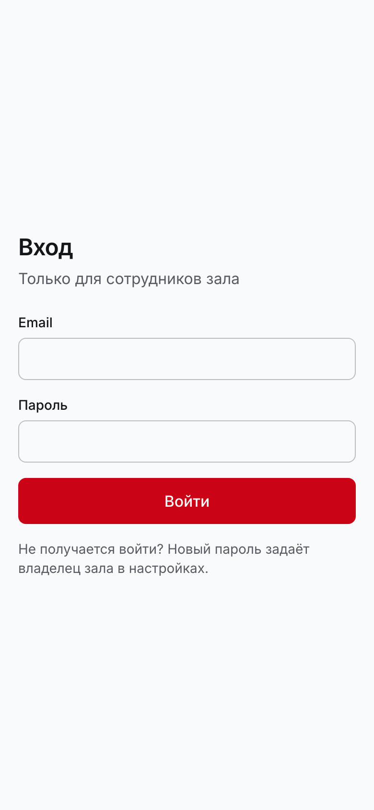
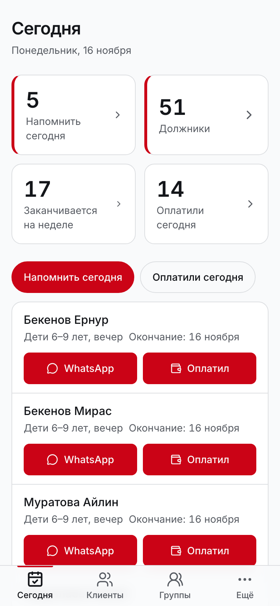
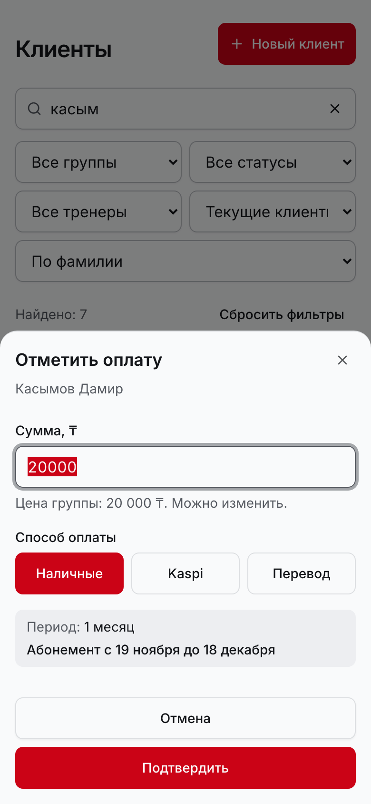
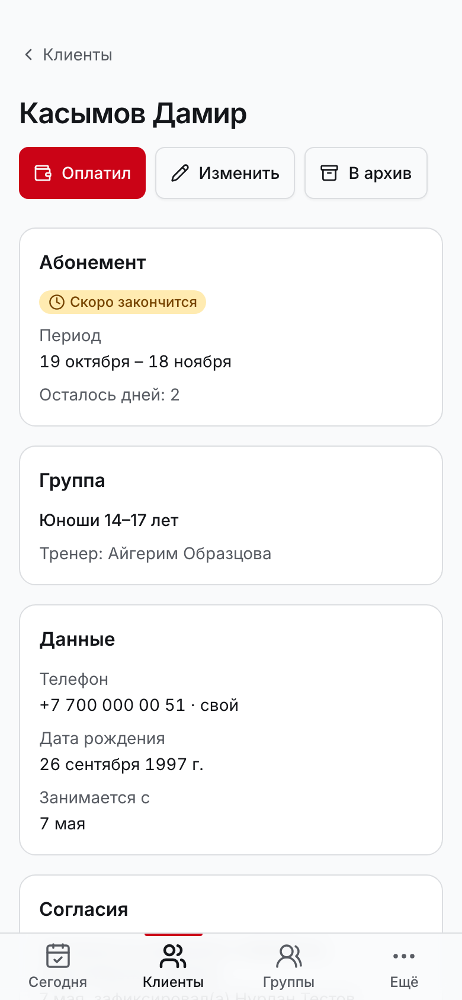
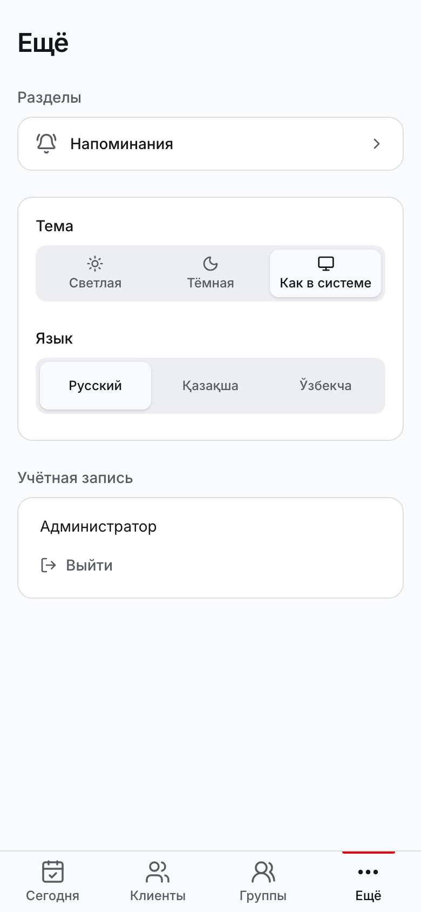

# Инструкция администратора

Сервис заменяет тетрадь: кто занимается, кто оплатил, кому пора напомнить. Адрес: `https://adilkhan-club.vercel.app`. Добавьте его на главный экран телефона, чтобы открывать одним нажатием.

На скриншотах вымышленные клиенты.

## Вход

Почта и пароль выдаёт владелец. При первом входе сервис попросит придумать свой пароль. Забыли пароль: попросите владельца задать новый.

## Каждый день: экран «Сегодня»

Открывается сразу после входа. Сверху четыре счётчика, нажмите любой, чтобы увидеть список. Ниже «Напомнить сегодня»: у этих клиентов абонемент скоро заканчивается или закончился.

- **WhatsApp**: откроется чат с клиентом (или с родителем ребёнка) и готовым текстом. Проверьте текст и нажмите «Отправить» в WhatsApp. В сервисе появится «Чат открыт». Сервис не знает, отправили ли вы сообщение, поэтому после отправки можно нажать «Отметить отправленным».
- **Оплатил**: клиент заплатил, отметьте оплату (ниже).

Пишите только с номера зала в WhatsApp Business.

## Найти клиента

«Клиенты» внизу → начните набирать фамилию, имя или последние цифры телефона. Список сужается сразу. Можно набирать и казахскими буквами: «Қасым» найдёт «Касымов».

## Отметить оплату

1. «Оплатил» в строке клиента (или в его карточке).
2. Сумма уже подставлена по цене группы, её можно изменить. Выберите способ: наличные, Kaspi или перевод. Ниже видно, до какого числа будет абонемент.
3. «Подтвердить». Появится «Оплата сохранена».

Ошиблись: нажмите «Отменить» во всплывающем сообщении или в карточке клиента в течение 10 минут. Позже исправить оплату может только владелец. Удалить оплату нельзя никому: в истории остаются и оплата, и отмена.

## Карточка клиента

Нажмите на имя. Здесь абонемент (до какого числа, сколько дней осталось), группа, телефон, согласия, история оплат и напоминаний. «Изменить» исправляет данные, «В архив» убирает ушедшего клиента из списка (история сохраняется).

Новый клиент: «Клиенты» → «Новый клиент». Для ребёнка укажите телефон и имя родителя и отметьте, что согласие получено.

## Язык, тема, выход

«Ещё» внизу:

- **Язык**: русский, казахский или узбекский. Выбор запоминается за вами и сохраняется на любом телефоне. Казахский и узбекский переводы пока черновые: если заметите ошибку, скажите владельцу.
- **Тема**: светлая, тёмная или как в телефоне.
- **Выйти**: если телефоном пользуется кто-то ещё.

## Что делает только владелец

Отчёты и выгрузка, журнал действий, настройки (название зала, группы и цены, тексты напоминаний, сотрудники), импорт клиентов из файла, исправление старых оплат, полное удаление клиента.
